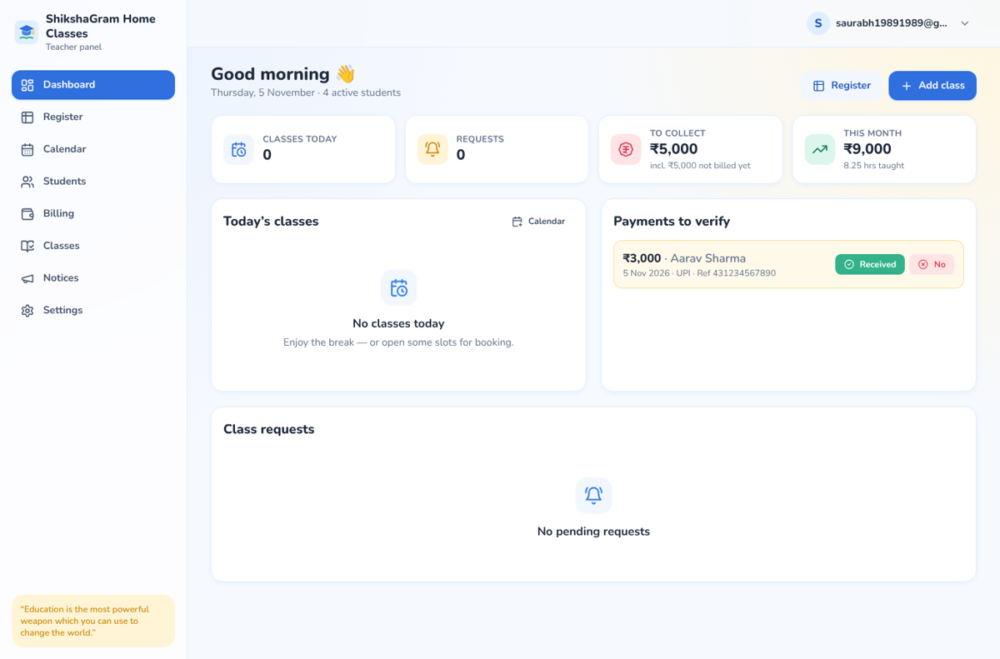
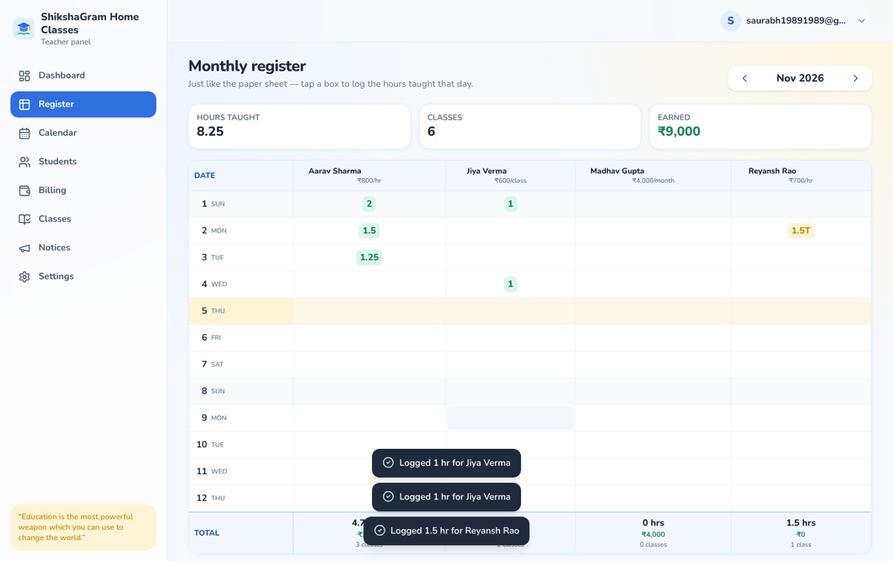
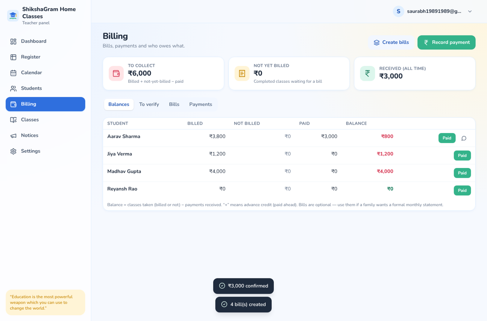
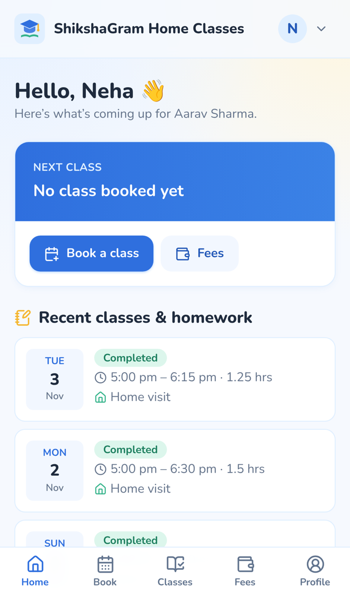
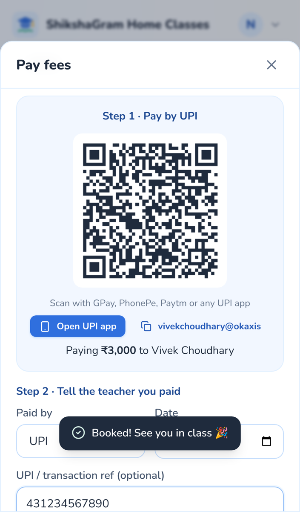

# ShikshaGram Home Classes

A simple web app for **Vivek Choudhary's home & online tuitions**: the teacher plus 10–15 students and their parents.

| Who | What they can do |
|---|---|
| **Teacher (admin)** | Dashboard · **Monthly register** (same layout as the paper sheet: dates × students, tap a box to log hours) · Calendar with open slots · Approve or decline class requests · Mark classes completed or missed, with topic and homework · Students and fee plans (per hour / per class / monthly) · Billing: balances, bills, record cash, confirm UPI payments, WhatsApp reminders · Notice board · Settings |
| **Parent / student** | Book an open slot (home or online) · Request a custom time · Cancel with notice · See upcoming classes, topics and homework · See the balance and pay by **UPI QR** · Notices |

* **Login:** email + 6-digit code (no password needed) **or** email + password. A device stays signed in as long as it's used at least once every **15 days** (`SESSION_DAYS` in `public/config.js`).
* **Linking families:** save the parent's (or student's) email on the student profile. When they sign up with that email, they're linked automatically. You can also link someone manually from the student's page.
* **Money:** balance = classes taken (billed or not) − payments received. Trial classes are free. Advance payments show as credit. Bills are optional; create them if a family wants a monthly statement.

Tech: React + Vite + Tailwind (static site) · Supabase (Postgres, Auth, row-level security). No server to run, so everything fits in free tiers.

---

## 1. Create the database (free Supabase project)

1. Sign in at <https://supabase.com/dashboard> with **saurabh19891989@gmail.com** and click **New project** (free plan; region **Mumbai – ap-south-1**).
2. Open **SQL Editor → New query**, paste all of [`supabase/schema.sql`](supabase/schema.sql), and click **Run**.
   It creates the tables, security rules and functions. `saurabh19891989@gmail.com` is the first admin; you can add Vivek's email later under **Settings → Admins** in the app.
3. **Authentication → Sign In / Providers → Email**: keep *Enable email provider* and *Confirm email* **on**.
4. **Authentication → Emails → Templates**: so emails show the 6-digit code,
   * *Magic Link*: paste [`supabase/email-templates/magic-link.html`](supabase/email-templates/magic-link.html)
   * *Confirm signup*: paste [`supabase/email-templates/confirm-signup.html`](supabase/email-templates/confirm-signup.html)
5. **Authentication → URL Configuration**: set **Site URL** to your app address (see step 3 below), e.g. `https://saurabh19891989-hue.github.io/tutionapp/`, and add the same URL to **Redirect URLs**.
6. **Strongly recommended: free email sending.** Supabase's built-in mailer only sends a few emails per hour, which isn't enough for login codes. Under **Authentication → Emails → SMTP Settings**, connect a free SMTP service:
   * **Brevo** (300 emails/day free) or **Resend** (3,000/month free). Create an account, verify a sender email, and copy its SMTP host, port, user and password into Supabase.
7. **Project Settings → API**: copy the **Project URL** and the **anon / publishable key**.

## 2. Connect the app to the database

Either:
* edit [`public/config.js`](public/config.js) and replace the two `YOUR-…` placeholders, **or**
* in GitHub: **Settings → Secrets and variables → Actions → Variables**, add `SUPABASE_URL` and `SUPABASE_ANON_KEY`. The deploy workflow fills them in.

The anon key is designed to be public. Row-level security in the database decides what each login can see: parents see only their own child's data, and only admins can change anything important.

## 3. Host it for free

### Option A: GitHub Pages (already set up in this repo)
1. Repo **Settings → Pages → Build and deployment → Source: GitHub Actions**.
2. Merge this branch into `main`. Every push to `main` runs [`.github/workflows/deploy.yml`](.github/workflows/deploy.yml) and publishes to
   **https://saurabh19891989-hue.github.io/tutionapp/**
3. Put that URL in Supabase **Site URL / Redirect URLs** (step 1.5).

### Option B: Cloudflare Pages / Netlify / Vercel (nicer free address)
Import the GitHub repo, then set **Build command** `npm run build` and **Output directory** `dist`.
You get a free address like `shikshagram.pages.dev`, `shikshagram.netlify.app` or `shikshagram.vercel.app`. Use that URL in Supabase step 1.5.
(If you use these instead of GitHub Pages, set the Supabase values in `public/config.js`.)

### Free domain?
* Truly free *custom* domains are no longer reliable: Freenom (.tk/.ml) shut down, and eu.org approvals can take months. **DigitalPlat FreeDomain** (e.g. `shikshagram.us.kg` / `.dpdns.org`) is free, but it's meant for hobby projects and you need to manage DNS yourself (e.g. free Cloudflare DNS).
* For a tuition business, the free host subdomain above is fine to start. Later, a real `.in` domain (for example `shikshagram.in`) costs about ₹500–900/year and can be pointed at any of the hosts above at no extra cost.

### Keep the free database awake
Free Supabase projects pause after ~1 week with no use (for example during holidays). [`.github/workflows/keep-alive.yml`](.github/workflows/keep-alive.yml) pings it twice a week once the `SUPABASE_URL` / `SUPABASE_ANON_KEY` repository variables are set.

## 4. First steps in the app
1. Sign in as `saurabh19891989@gmail.com`. You'll see the teacher panel.
2. **Settings**: add the UPI ID (for the payment QR code), phone, and Vivek's email under *Admins*.
3. **Students**: add each student with their fee plan and parent email.
4. Share the app link with parents (**Settings → Invite families → Share**).
5. Day to day: log classes in the **Register** (tap a box → pick 1 / 1.25 / 1.5 / 2 hrs), or open slots in the **Calendar** for families to book. Confirm UPI payments from the **Dashboard**.

## Run locally (for development)
```bash
npm install
npm run dev      # http://localhost:5173
npm run build    # production files in dist/
```
Add `http://localhost:5173` to Supabase Redirect URLs for local email-link testing.

## Project layout
```
public/config.js          Supabase URL/key + brand name + session days
supabase/schema.sql       Tables, row-level security, booking & billing functions
supabase/email-templates  Login/confirm emails with the 6-digit code
src/pages/admin/          Teacher panel (Dashboard, Register, Students, Billing, Notices, Settings)
src/pages/member/         Parent/student Home and Fees
src/pages/                Shared Calendar, Classes, Profile, Login
```

## Screenshots
| Teacher dashboard | Monthly register |
|---|---|
|  |  |

| Billing | Parent home (phone) | Pay by UPI |
|---|---|---|
|  |  |  |
